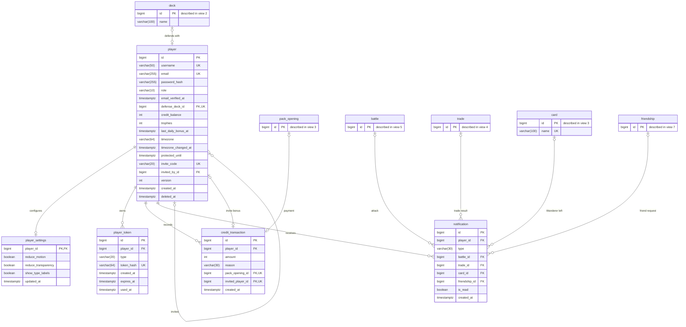
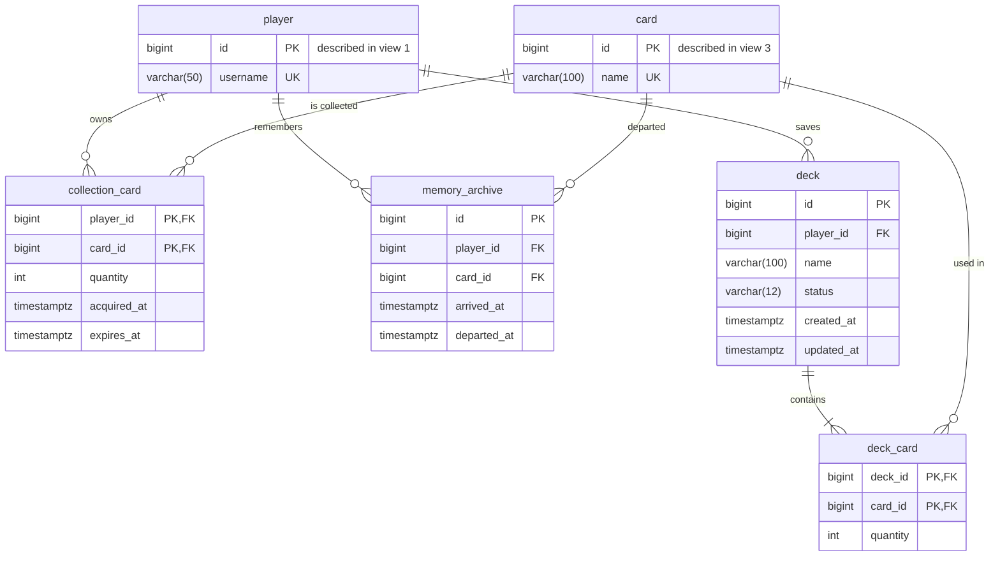
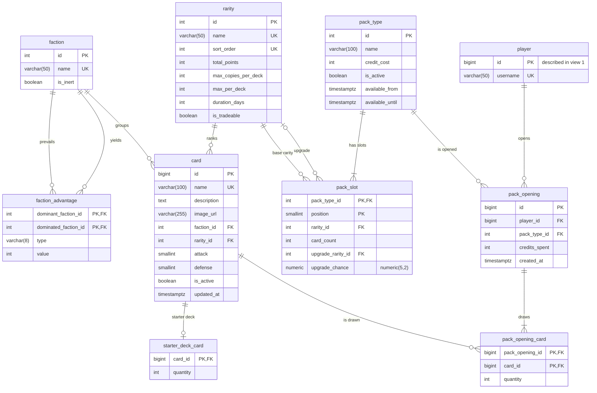
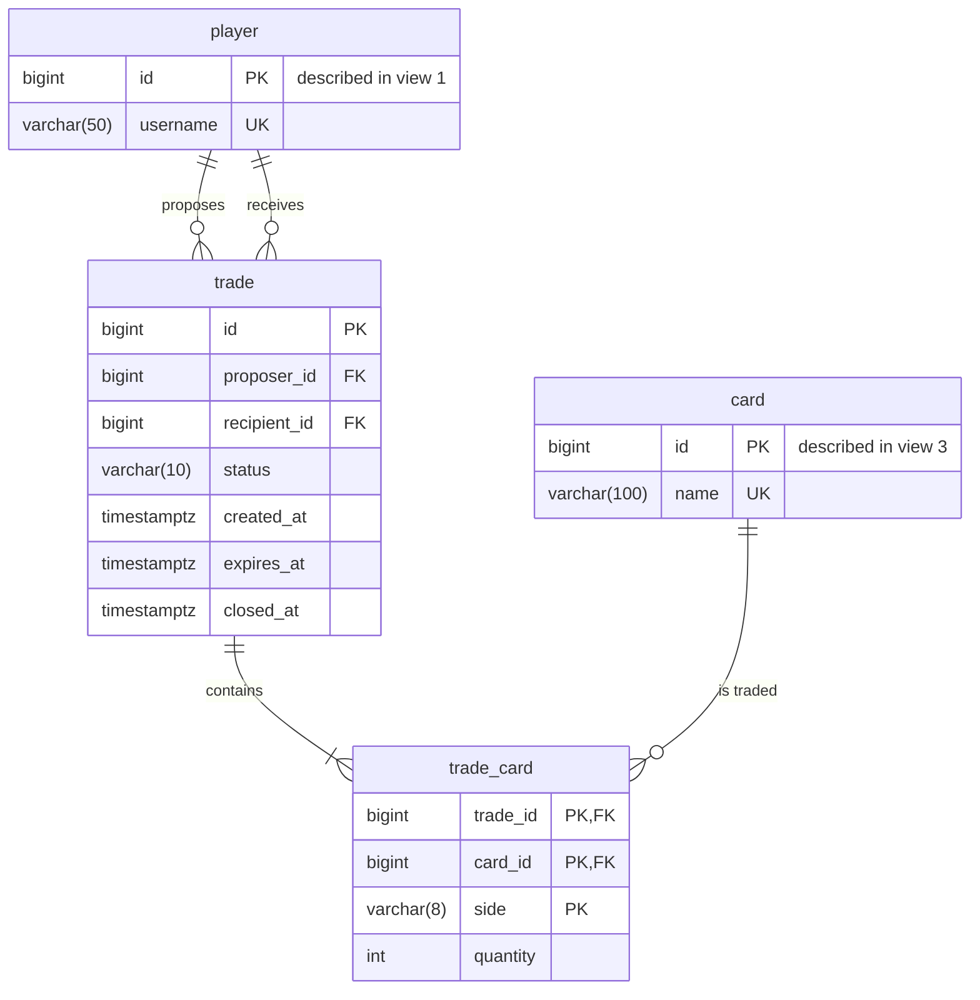
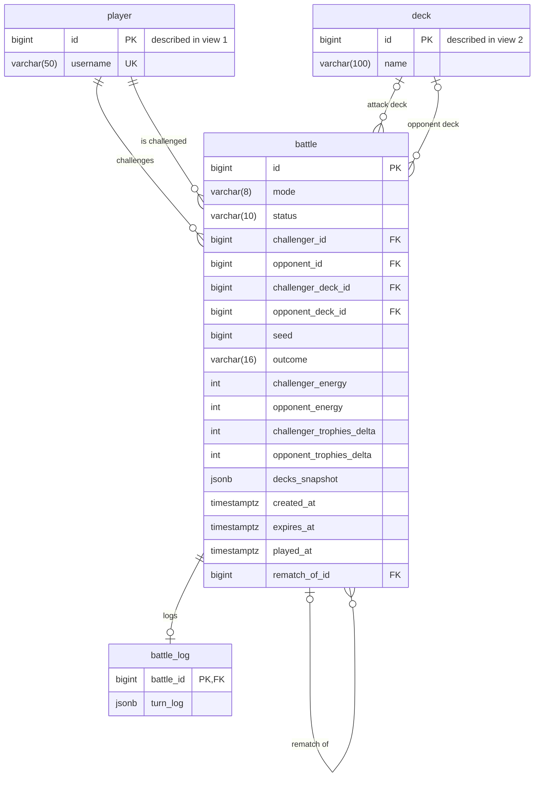
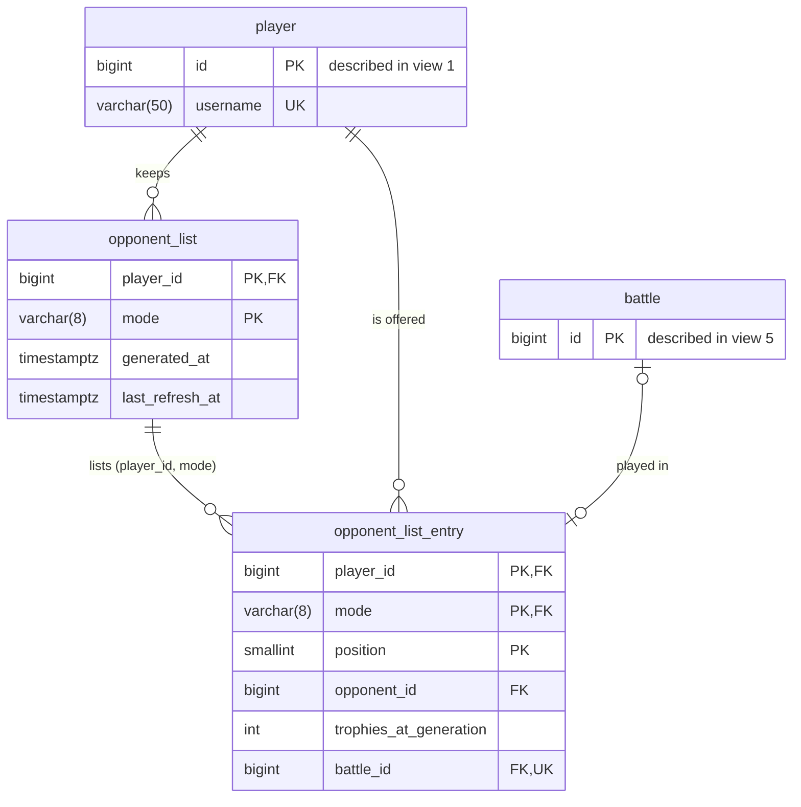
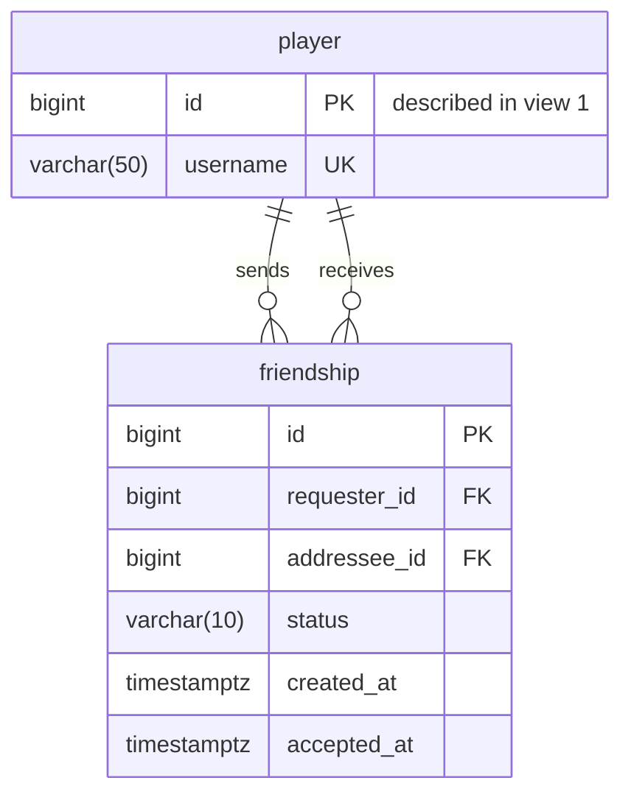
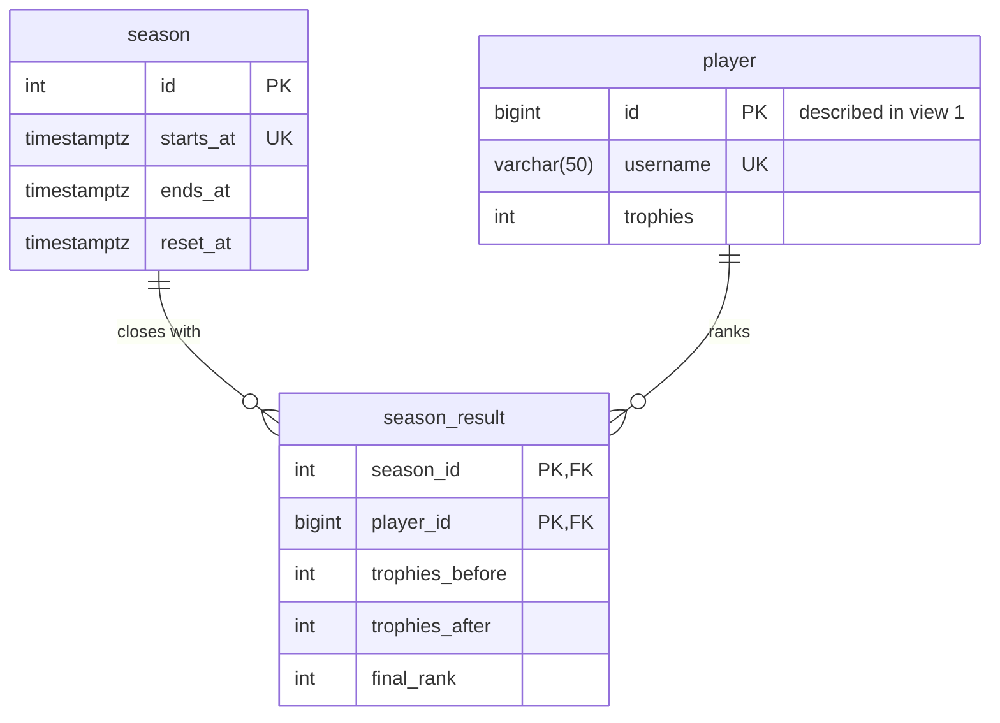

# Will of the Void – Database schema

The database runs on PostgreSQL 16 and has 27 tables, split into 8 views. Each view shows one area of the game and the relationships between its tables.

The schema source is [`schema.sql`](schema.sql): every table declares its own foreign keys, and the unique indexes at the end enforce game rules such as case-insensitive usernames and one registration bonus per player. When the schema changes, the diagrams in this file are updated by hand. The same script is the first Flyway migration, `api/src/main/resources/db/migration/V1__init.sql`: once applied it is never edited, and every later change goes into a new `V2__...` migration.

| Area | Tables | Contents |
| --- | --- | --- |
| [1 · Player, credits and notifications](#1--player-credits-and-notifications) | `player`, `player_settings`, `player_token`, `credit_transaction`, `notification` | The account with its settings and tokens, every credit income or expense with its origin, and the notifications shown when the player comes back. |
| [2 · Collection and decks](#2--collection-and-decks) | `collection_card`, `memory_archive`, `deck`, `deck_card` | The cards each player owns, the departed Wanderers, and the saved decks with their cards. |
| [3 · Catalog and packs](#3--catalog-and-packs) | `faction`, `faction_advantage`, `rarity`, `card`, `starter_deck_card`, `pack_type`, `pack_slot`, `pack_opening`, `pack_opening_card` | The card catalog with factions, advantages and rarities, the starter deck, the pack types with their slots, and the history of opened packs. |
| [4 · Trades](#4--trades) | `trade`, `trade_card` | Trades between two players, with the cards offered and requested. |
| [5 · Battles](#5--battles) | `battle`, `battle_log` | Battles in every mode (FRIEND, QUICK, RANKED) with result, energy and trophies, and the turn-by-turn log kept apart. |
| [6 · Matchmaking](#6--matchmaking) | `opponent_list`, `opponent_list_entry` | The saved list of 5 opponents per mode, and the battle played against each of them. |
| [7 · Friendships](#7--friendships) | `friendship` | Friend requests and accepted friendships. |
| [8 · Seasons](#8--seasons) | `season`, `season_result` | The 4-week ranked seasons and, for each player, the trophies before and after the end-of-season reset with their final rank. |

## How to read the diagrams

The diagrams are written in [Mermaid](https://mermaid.js.org/syntax/entityRelationshipDiagram.html), so GitHub draws them directly from this file and they are edited as text.

- **Every table** lists its columns with type and keys: **PK** primary key, **FK** foreign key, **UK** unique.
- **A table described in another view** shows only the linked columns, and the first one says which view describes it.
- **The label on a line** reads as a sentence from the first table to the second: *player saves deck*.

The symbol at each end of a line says how many rows of that table match one row of the table at the other end:

| Symbol | Mermaid | Meaning |
| --- | --- | --- |
| two bars | `\|\|` | exactly one |
| circle + bar | `\|o` / `o\|` | zero or one |
| crow's foot + bar | `\|{` / `}\|` | one or more |
| crow's foot + circle | `o{` / `}o` | zero or more |

In the relationship tables below, the **Cardinality** column reads from parent to child: "1 → 0..N" means that one parent row matches zero or more child rows.

## 1 · Player, credits and notifications

Everything starts from `player`: the accessibility settings synced with the account are in `player_settings`, the tokens for email verification, password reset and login refresh are in `player_token`, every change to the credit balance is recorded with its origin in `credit_transaction`, and what happens while the player is offline ends up in `notification`.

| Relationship | Cardinality | Meaning |
| --- | --- | --- |
| player → player_settings.player_id | 1 → 0..1 | The player's settings, one row per player: `player_id` is both primary and foreign key. The row is created at registration with the default values, and deleted with the player. |
| player → player_token.player_id | 1 → 0..N | Email verification, password reset and JWT refresh tokens. Only the SHA-256 hash of the token is stored (`token_hash`, UNIQUE); `used_at` marks a token already used. |
| player → credit_transaction.player_id | 1 → 0..N | Every credit income or expense is a row. The balance in `player` is the sum of the transactions, updated in the same database transaction. |
| player → notification.player_id | 1 → 0..N | Notifications shown when the player comes back: attacks received, challenge requests, trade results, departed Wanderers, friend requests. |
| deck → player.defense_deck_id | 0..1 → 0..1 | The foreign key lives in `player`. Empty means no defense deck, so the player cannot attack. UNIQUE: a deck defends at most one player. |
| player → player.invited_by_id | 0..1 → 0..N | A relationship of the table with itself: who invited whom. A player can invite many others; each has at most one inviter. |
| pack_opening → credit_transaction.pack_opening_id | 0..1 → 0..1 | The payment for a pack: one opening produces one transaction. |
| player → credit_transaction.invited_player_id | 0..1 → 0..1 | The invite bonus, linked to the invited friend. UNIQUE: each invited player triggers the bonus once, after their 10th battle. |
| battle → notification.battle_id | 0..1 → 0..N | The battle behind an "attack received" notification, or the challenge request received, accepted, rejected, expired or cancelled. |
| trade → notification.trade_id | 0..1 → 0..N | The trade that was received, accepted, rejected, cancelled, expired or failed. |
| card → notification.card_id | 0..1 → 0..N | The Wanderer that left the ship. |
| friendship → notification.friendship_id | 0..1 → 0..N | The friend request received or accepted. ON DELETE CASCADE: when a request is rejected or a friend removed, the row is deleted and so are its notifications. |

Five columns of `player` are not relationships but support game rules: `protected_until` (protection after N attacks received), `last_daily_bonus_at`, `timezone` and `timezone_changed_at` (daily login bonus) and `deleted_at` (soft delete: on deletion, username and email are anonymised).

**Username and email are unique ignoring case.** The uniqueness is given by two expression indexes, `uq_player_username_lower` and `uq_player_email_lower` on `lower(...)`, so `Mario@mail.com` and `mario@mail.com` cannot both exist. The diagram marks the two columns as UK.

**Credits and trophies are changed with atomic UPDATEs.** A player's trophies change when someone else attacks them, so the `player` row is updated by requests the player does not control. To avoid lost updates and conflicts, `credit_balance` and `trophies` are never written through the JPA entity: they change only with statements such as `UPDATE player SET credit_balance = credit_balance - :cost WHERE id = :id AND credit_balance >= :cost`, and the service checks that one row was updated. In the entity the two columns are mapped with `@Column(insertable = false, updatable = false)`. The service also clamps the Elo result at 0, because `trophies >= 0` is a CHECK constraint. `version` (optimistic locking) protects only the profile data.

**`credit_transaction` is consistent with its reason.** A CHECK constraint ties each reason to its columns: PACK_PURCHASE has `pack_opening_id` and a negative amount, INVITE_BONUS has `invited_player_id` and a positive amount, REGISTRATION_BONUS and DAILY_BONUS have neither and a positive amount. The partial unique index `uq_credit_registration_bonus` allows only one registration bonus per player.

**The daily bonus follows the player's day, not the server's.** `timezone` holds the player's IANA time zone (for example `Europe/Rome`), read from the browser at registration and checked by the backend. The time always comes from the server clock, converted to the player's time zone, so changing the computer clock does not give a second bonus. A single atomic UPDATE sets `last_daily_bonus_at` only if the last bonus fell on an earlier day in the player's calendar, `(last_daily_bonus_at AT TIME ZONE timezone)::date < (now() AT TIME ZONE timezone)::date`; if one row was updated, the service adds the DAILY_BONUS transaction. The new bonus is therefore available from midnight in the player's time zone.

**The time zone can change once a month.** Otherwise a player could move their time zone forward to start the next day early and collect an extra bonus. The time zone set at registration does not count as a change; after that, an atomic UPDATE changes it only if `timezone_changed_at` is empty or at least 30 days old, and sets `timezone_changed_at` to now. At most, changing the time zone gives one extra bonus a month.

**Settings are synced with the account.** `player_settings` keeps the accessibility options as booleans, so they follow the player on every browser and device. Each column says what happens when it is true: `reduce_motion` reduces animations, `reduce_transparency` replaces transparent surfaces with solid ones, `show_type_labels` adds text labels next to colour-coded information. It is a separate table so that changing a setting never conflicts with the optimistic locking (`version`) of the profile, and a new setting is just a new column.

In phase 1 credits come from three sources: the registration bonus, the daily login bonus and the invite bonus. They are spent on packs.

## 2 · Collection and decks

Owned cards are stored in `collection_card` as quantities (one row per player and card), expired Wanderers move to `memory_archive`, and decks list their cards in `deck_card`.

| Relationship | Cardinality | Meaning |
| --- | --- | --- |
| player → collection_card.player_id | 1 → 0..N | The cards on board the player's ship. Extra copies increase `quantity` instead of adding rows. |
| card → collection_card.card_id | 1 → 0..N | The same card can be in many players' collections. With the relationship above, it forms a many-to-many between players and cards. |
| player → memory_archive.player_id | 1 → 0..N | The player's departed Wanderers: visible but not playable. |
| card → memory_archive.card_id | 1 → 0..N | The same Wanderer can leave and come back several times: each stay is a row, so the key is an `id`. |
| player → deck.player_id | 1 → 0..N | A player can save any number of decks; each deck has one owner. Deck names are unique per player (`uq_deck_player_name`). |
| deck → deck_card.deck_id | 1 → 1..N | The deck's cards with their copies. Deleting a deck deletes its rows. |
| card → deck_card.card_id | 1 → 0..N | A card can appear in many decks. With the relationship above, it forms a many-to-many between decks and cards. |

A Wanderer's life cycle uses two tables. When found in a pack it enters `collection_card` with `acquired_at` set to the arrival time and `expires_at` 7 days later. A Wanderer always has quantity 1: if it is found again while still on board, only `expires_at` moves forward by 7 days, and `acquired_at` stays the same. Two CHECK constraints enforce this: `expires_at IS NULL OR quantity = 1` and `expires_at > acquired_at`. When it expires, a scheduled job moves it to `memory_archive` (copying `acquired_at` into `arrived_at`), invalidates the decks that used it and creates a notification.

**When `deck.status` is recomputed.** The status is stored so it does not have to be computed on every read, and it is recomputed in three cases: a card is edited in the backoffice, a Wanderer departs, and a trade is accepted. In the last case, if a player trades away cards used in one of their decks, including the defense deck, that deck becomes INVALID and the player receives a DECK_INVALID notification.

## 3 · Catalog and packs

Every card has a faction and a rarity. The game rules (faction advantages, rarity limits, starter deck, pack contents) live in tables that the backoffice can edit, not in the code.

| Relationship | Cardinality | Meaning |
| --- | --- | --- |
| faction → card.faction_id | 1 → 0..N | Every card belongs to one of the 7 factions. The Noble Gases have `is_inert` = true: no advantage or disadvantage. |
| faction → faction_advantage.dominant_faction_id | 1 → 0..N | The faction that prevails in the clash. |
| faction → faction_advantage.dominated_faction_id | 1 → 0..N | The faction that is overpowered. With the relationship above, it forms a many-to-many of the table with itself: 12 rows, each with a type (ATTACK or DEFENSE) and a value. A unique index on `LEAST` and `GREATEST` of the two ids (`uq_faction_advantage_pair`) prevents having both A > B and B > A. |
| rarity → card.rarity_id | 1 → 0..N | The card's rarity. `rarity` also stores total points, maximum copies, maximum per deck, duration and whether the card can be traded. |
| card → starter_deck_card.card_id | 1 → 0..1 | The 30 cards of the starter deck, the same for every new player. Each card appears at most once, with its copies in `quantity`. |
| pack_type → pack_slot.pack_type_id | 1 → 1..N | The pack's slots. The total number of cards is the sum of `card_count`. |
| pack_type.available_from / available_until | – | The purchase window of an event pack. Both empty for the regular packs, which are always on sale. |
| rarity → pack_slot.rarity_id | 1 → 0..N | The base rarity of the cards in the slot. |
| rarity → pack_slot.upgrade_rarity_id | 0..1 → 0..N | The rarity the slot can turn into, with probability `upgrade_chance`. This is how Wanderers stay rare. |
| pack_type → pack_opening.pack_type_id | 1 → 0..N | Every opening refers to one pack type. |
| player → pack_opening.player_id | 1 → 0..N | Who opened the pack and how much they paid that day (`credits_spent`). |
| pack_opening → pack_opening_card.pack_opening_id | 1 → 1..N | The cards drawn in that opening. |
| card → pack_opening_card.card_id | 1 → 0..N | A card can be drawn in many openings; two copies in the same pack are one row with `quantity` 2. |

**How a pack keeps a fixed number of cards per rarity and still makes Wanderers rare.** Each slot has a fixed number of cards of a base rarity. A slot can also have an upgrade: with probability `upgrade_chance`, its cards come from `upgrade_rarity_id` instead. For example, a slot of 1 Champion with a 5% upgrade to Wanderer gives a Wanderer in about one pack out of twenty. Two CHECK constraints require `upgrade_rarity_id` and `upgrade_chance` to be both set or both empty, and the upgrade rarity to differ from the base one. In `rarity`, `max_per_deck` and `duration_days` must be greater than 0 when they are set.

**Wanderers are found only during events.** Regular packs have no slot that upgrades to Wanderer. Each event has its own `pack_type` with a Wanderer upgrade slot and a purchase window, `available_from` to `available_until`: the backend sells it only inside that window, so no probability has to be changed when an event starts or ends. A CHECK constraint (`chk_pack_availability_window`) requires the end to come after the start. Every opening points to its `pack_type`, so the history always shows which pack, and which probabilities, a Wanderer came from.

The opening history makes it possible to show that the pack probabilities work as declared.

## 4 · Trades

A trade links two players, and every card involved is a row of `trade_card` with its side: OFFER (from proposer to recipient) or REQUEST (from recipient to proposer). Trades such as 3 for 1 or 1 for 5 are just a different number of rows.

| Relationship | Cardinality | Meaning |
| --- | --- | --- |
| player → trade.proposer_id | 1 → 0..N | Who proposes the trade. |
| player → trade.recipient_id | 1 → 0..N | Who receives it and decides whether to accept it within 48 hours (`expires_at`). |
| trade → trade_card.trade_id | 1 → 1..N | The trade's cards; a trade without cards does not exist. |
| card → trade_card.card_id | 1 → 0..N | The same card can appear in many trades at once: even a single copy can be offered to several players. |

Because the same copy can be offered to several players, ownership is checked when the recipient accepts, not when the trade is proposed. Accepting a trade locks the `collection_card` rows involved (`SELECT ... FOR UPDATE`): if two players accept at the same instant, the second one finds the card already transferred and their trade becomes FAILED. Wanderers cannot be traded (`rarity.is_tradeable` = false). A CHECK constraint requires `closed_at` to be empty exactly while the trade is PENDING A scheduled job expires trades after 48 hours. Accepting a trade also recomputes the decks of both players (see view 2).

## 5 · Battles

A single `battle` table serves every mode: FRIEND (against a friend), QUICK and RANKED (against an opponent from the list). The turn-by-turn log is in a separate table, `battle_log`.

**Instant battle or request.** If the opponent has an active, VALID defense deck, the battle is played at once against that deck. Otherwise it becomes a request (status PENDING) that the opponent can accept within 48 hours, choosing their deck at that moment; the challenger's deck is the one they had when sending it, saved in `decks_snapshot`. This holds for FRIEND, QUICK and rematches. RANKED is always instant and requires a valid defense deck from both players, so choosing a deck never gives an advantage there. An INVALID defense deck counts as no defense deck: a player who wants to choose their deck every time can simply remove it.

| Relationship | Cardinality | Meaning |
| --- | --- | --- |
| player → battle.challenger_id | 1 → 0..N | Who attacks or sends the request. |
| player → battle.opponent_id | 1 → 0..N | The player who defends with their defense deck, or who receives the request and accepts it. |
| deck → battle.challenger_deck_id | 0..1 → 0..N | The attack deck chosen by the challenger. If the deck is deleted the column is emptied, but the battle stays in the history and a pending request still has its copy in `decks_snapshot`. |
| deck → battle.opponent_deck_id | 0..1 → 0..N | The opponent's deck: their defense deck in an instant battle, the deck chosen when accepting a request. Empty while the request is PENDING. Same behaviour on deletion. |
| battle → battle.rematch_of_id | 0..1 → 0..N | A relationship of the table with itself: the battle this one is a rematch of. Rematches exist only in FRIEND and QUICK, where no trophies are at stake, so a battle can have any number of rematches. |
| battle → battle_log.battle_id | 1 → 0..1 | The turn-by-turn log, one row per PLAYED battle. It is a separate table, mapped LAZY, so that the history list does not load every log. Deleting a battle deletes its log. |

**Energy and trophies.** Each player starts a battle with 0 energy. Defeating an opposing card generates energy, and the first player to reach 30 energy wins. `challenger_energy` and `opponent_energy` store the final values. Trophies are the ranking: they are awarded after a RANKED battle with the Elo formula and K = 32, so a battle between players with the same trophies moves 16 trophies, and beating a stronger player gives more. `challenger_trophies_delta` and `opponent_trophies_delta` store how many each player gained or lost. Trophies are partly reset at the end of each season (see view 8).

A battle keeps everything needed to replay it: the `seed` generated by the server, the copy of both decks (`decks_snapshot`, `jsonb`; a pending request holds only the challenger's deck) and, in `battle_log`, the turn-by-turn log (`turn_log`, `jsonb`). Battles already played stay correct even if a deck or a card changes later.

CHECK constraints on `battle`:

| Constraint | Rule |
| --- | --- |
| chk_battle_different_players | Challenger and opponent are different players. |
| chk_battle_outcome_when_played | `outcome` is set exactly when the status is PLAYED. |
| chk_battle_trophies_ranked_only | The trophy deltas are set only in RANKED. |
| chk_battle_ranked_instant | A RANKED battle is always PLAYED: it is never a request. |
| chk_battle_pending_expiry | A PENDING request has `expires_at` (48 hours after it was sent). |
| chk_battle_has_snapshot | A PENDING or PLAYED battle has `decks_snapshot`, so deleting a deck while a request is waiting does not break it. |
| chk_battle_rematch_not_ranked | `rematch_of_id` is never set in RANKED. |

The partial unique index `uq_battle_pending_pair` allows at most one PENDING request between the same two players, in either direction. A scheduled job sets requests to EXPIRED after 48 hours.

## 6 · Matchmaking

Every player has a saved list of 5 opponents for each mode (QUICK, RANKED): `opponent_list` is the header with the refresh time, `opponent_list_entry` holds the 5 opponents and, once a battle has been played, the battle against each of them.

| Relationship | Cardinality | Meaning |
| --- | --- | --- |
| player → opponent_list.player_id | 1 → 0..N | One list per mode: the primary key is player + mode. It stores when the list was generated and when it was last refreshed. |
| opponent_list → opponent_list_entry.(player_id, mode) | 1 → 0..5 | Composite foreign key: the entries belong to that list. The primary key includes the position from 1 to 5, so a list cannot have more than 5 entries. |
| player → opponent_list_entry.opponent_id | 1 → 0..N | The player offered as an opponent, with the trophies they had when the list was generated. A CHECK constraint excludes the player themselves, and `uq_opponent_list_entry_opponent` prevents the same opponent appearing twice in a list. |
| battle → opponent_list_entry.battle_id | 0..1 → 0..1 | The battle played against that opponent. It is set only when the battle is PLAYED: at once for an instant battle, on acceptance for a request. Empty means not played yet, so a rejected or expired request leaves the opponent available. An opponent can be played against only once per list, so trophies cannot be farmed by attacking the same weak player again and again. UNIQUE: a battle belongs to at most one entry. |

The list is stored server-side because the API is stateless: reloading the page does not produce a new list, and the server accepts a battle or a request only against an opponent in the list for that mode whose `battle_id` is still empty (and, thanks to `uq_battle_pending_pair`, with no request already pending). If the list is refreshed while a request is pending and the request is accepted later, the battle is played but no entry is linked. Refreshing the list is limited by a cooldown measured from `last_refresh_at`. `trophies_at_generation` is for display only: the trophy calculation after a battle always uses the current values.

## 7 · Friendships

A friendship is a row with the player who sent the request and the one who received it. Any friend can be challenged in FRIEND mode, online or not: if they have no valid defense deck, the challenge waits for them as a 48-hour request (see view 5).

| Relationship | Cardinality | Meaning |
| --- | --- | --- |
| player → friendship.requester_id | 1 → 0..N | Who sends the friend request. |
| player → friendship.addressee_id | 1 → 0..N | Who receives it and accepts or rejects it. |

A friendship between A and B is the same as one between B and A. A unique index on `LEAST` and `GREATEST` of the two ids prevents both rows from existing.

Rejecting a request or removing a friend deletes the row, so the status is only PENDING or ACCEPTED, and the same two players can send a new request later. `accepted_at` is set exactly when the status is ACCEPTED (CHECK constraint).

## 8 · Seasons

Ranked play is split into seasons of 4 weeks. At the end of a season the trophies above 1000 are halved, so the ranking keeps its order but the gaps shrink and the top players have to play again to stay on top. Players at 1000 trophies or below are not touched.

| Relationship | Cardinality | Meaning |
| --- | --- | --- |
| season → season_result.season_id | 1 → 0..N | The results of the season, written when it is reset. |
| player → season_result.player_id | 1 → 0..N | The player's trophies before and after each reset, and their final rank. The primary key is season + player, so a player has one result per season. |

**The reset.** New trophies = 1000 + (trophies − 1000) / 2, only for players above 1000: 1200 becomes 1100, 2000 becomes 1500. When `ends_at` has passed, a scheduled job runs in one transaction:

1. It writes a `season_result` row for every player who has not been deleted, with the current trophies, the trophies after the reset and the rank (`rank() OVER (ORDER BY trophies DESC)`).
2. It lowers `player.trophies` with an atomic UPDATE that subtracts the reduction (`trophies_before - trophies_after`) instead of writing the new value (never going below 0), so a battle finished at the same instant is not lost.
3. It sets `season.reset_at`, so the same season is never reset twice, and creates the next season.

The three numbers (K = 32, 4 weeks, threshold 1000) are backend settings, not database values, so they can be changed without a migration. With K = 32, an even battle moves 16 trophies, so the threshold is reached after several seasons of steady winning: the reset only concerns the best players.

Two CHECK constraints keep `season` consistent (`ends_at` after `starts_at`, `reset_at` not before `ends_at`), and `chk_season_result_not_increased` ensures that a reset never adds trophies.

## Enumerated values

Enumerated values are `varchar` columns with a CHECK constraint, mapped in Java with `@Enumerated(EnumType.STRING)`. Adding a value means changing the CHECK constraint in a new Flyway migration.

| Column | Allowed values |
| --- | --- |
| player.role | USER, ADMIN (Spring Security adds the `ROLE_` prefix) |
| credit_transaction.reason | REGISTRATION_BONUS, DAILY_BONUS, INVITE_BONUS, PACK_PURCHASE |
| player_token.type | EMAIL_VERIFICATION, PASSWORD_RESET, REFRESH |
| notification.type | ATTACK_RECEIVED, TRADE_RECEIVED, TRADE_ACCEPTED, TRADE_REJECTED, TRADE_CANCELLED, TRADE_EXPIRED, TRADE_FAILED, WANDERER_DEPARTED, DECK_INVALID, INVITE_BONUS, FRIEND_REQUEST_RECEIVED, FRIEND_REQUEST_ACCEPTED, CHALLENGE_RECEIVED, CHALLENGE_ACCEPTED, CHALLENGE_REJECTED, CHALLENGE_EXPIRED, CHALLENGE_CANCELLED |
| deck.status | INCOMPLETE, VALID, INVALID |
| faction_advantage.type | ATTACK, DEFENSE |
| trade.status | PENDING, ACCEPTED, REJECTED, CANCELLED, EXPIRED, FAILED |
| trade_card.side | OFFER, REQUEST |
| battle.mode | FRIEND, QUICK, RANKED |
| battle.status | PENDING, REJECTED, EXPIRED, CANCELLED, PLAYED |
| battle.outcome | CHALLENGER_WIN, OPPONENT_WIN, DRAW |
| opponent_list.mode | QUICK, RANKED |
| friendship.status | PENDING, ACCEPTED |

## Rules the database does not enforce on its own

Foreign keys only check that a linked row exists, not the game rules. These are checked in the Spring Boot services, inside a transaction.

| Rule | Where it is checked |
| --- | --- |
| The defense deck and the attack deck belong to the player using them | Setting the defense deck, creating a battle |
| A deck does not use more copies than the player owns | Saving a deck, accepting a trade (the decks of both players are recomputed) |
| Valid deck: 30 cards, copy and rarity limits, at most 15 cards per faction | Saving a deck, editing a card in the backoffice, a Wanderer expiring |
| The starter deck is always valid and has no Wanderers | Editing the starter deck or one of its cards in the backoffice |
| Backoffice cards match their rarity: total points correct, Noble Gases always Wanderers | Creating and editing a card |
| The cards drawn match the pack slots and their upgrade chances | Opening a pack |
| Card ownership and no duplication in trades | Accepting a trade, with a pessimistic lock |
| Wanderers cannot be traded | Proposing and accepting a trade |
| One daily bonus per day in the player's time zone | Logging in, with an atomic UPDATE on `last_daily_bonus_at` |
| `player.timezone` is a valid IANA time zone | Registration and profile update (`ZoneId.of`) |
| The time zone changes at most once every 30 days | Profile update, with an atomic UPDATE on `timezone_changed_at` |
| Every player has a `player_settings` row | Registration, in the same transaction |
| Invite bonus only after the invited player's 10th battle | Saving each battle of an invited player |
| A challenge request and a trade are accepted within 48 hours | Accepting, checking `expires_at` server-side; a job marks them EXPIRED |
| A battle is instant only if the opponent's defense deck is VALID; RANKED requires a valid defense deck from both players | Starting a battle |
| An opponent list entry gets its `battle_id` only when the battle is PLAYED | Playing an instant battle, accepting a request |
| Opponent list refreshed only after the cooldown | Refreshing the list, checking `last_refresh_at` |
| Credits and trophies never go below 0 and are not overwritten by stale entities | Atomic UPDATEs only; Elo result clamped at 0 |
| Seasons do not overlap, and each one starts when the previous one ends | Creating a season, in the reset job |
| A season is reset once, after `ends_at` | The reset job, checking that `reset_at` is empty |
| A Wanderer found again extends its stay instead of adding a copy | Opening a pack |
| Only event packs (with a purchase window) have a slot that upgrades to Wanderer | Creating and editing a pack type in the backoffice |
| An event pack is sold only between `available_from` and `available_until` | Buying a pack, checking the time server-side |

Rules that involve only the columns of one row are CHECK constraints in the schema, so the database enforces them: positive quantities, attack and defense from 1 to 10, two different players in a trade, battle, friendship or opponent list, a credit transaction consistent with its reason, a trade closed only when it is no longer PENDING, the battle columns that depend on the mode and status, a single copy for Wanderers.
