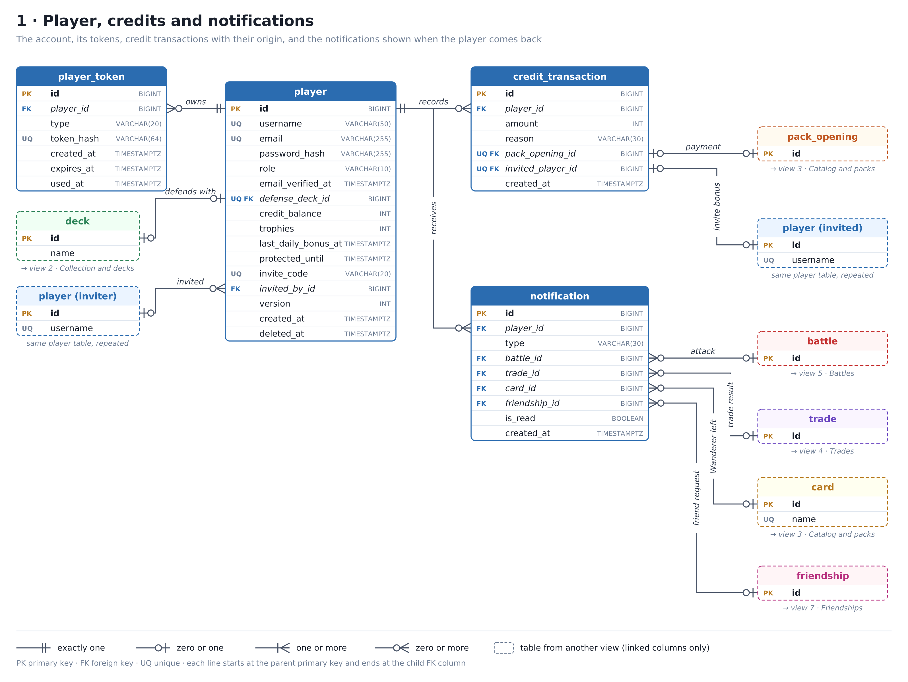
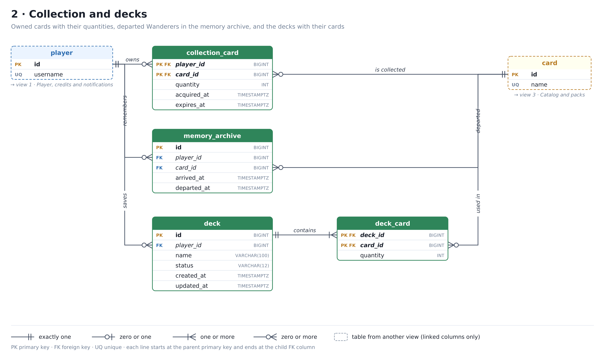
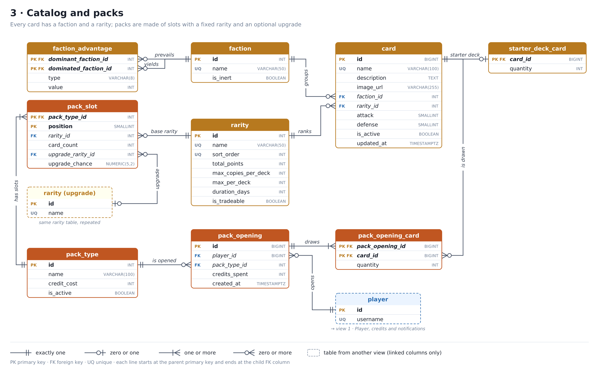
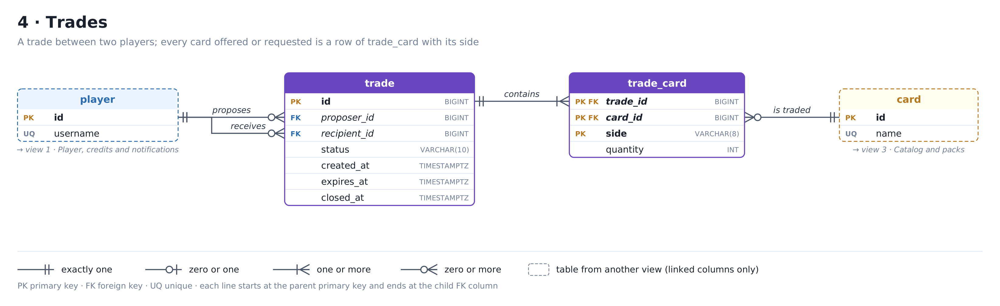
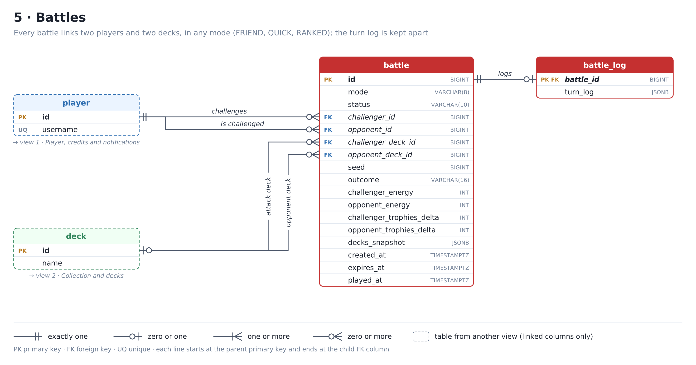
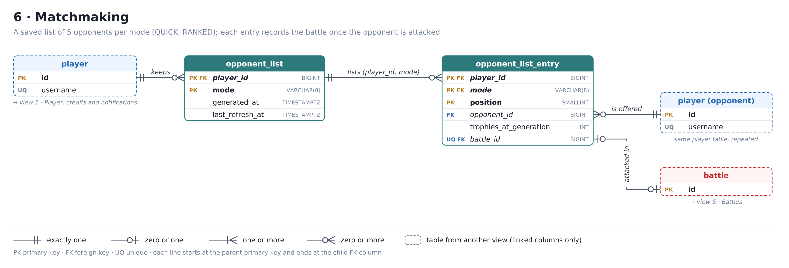
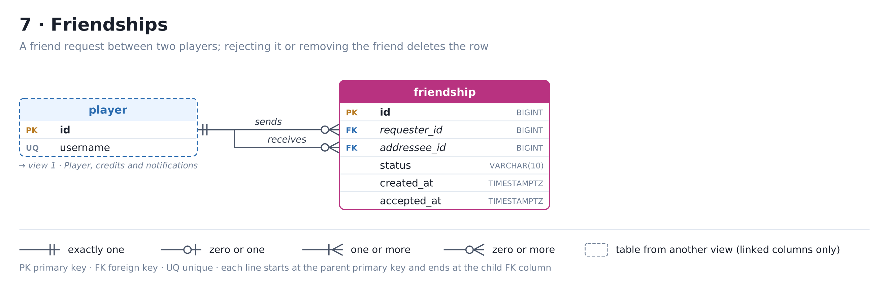

# Will of the Void – Database schema

The database runs on PostgreSQL 16 and has 24 tables, split into 7 views. Each view shows one area of the game and the relationships between its tables, with no crossing lines.

The schema source is [`will-of-the-void.dbml`](will-of-the-void.dbml) (paste it into [dbdiagram.io](https://dbdiagram.io)); [`schema.sql`](schema.sql) is the PostgreSQL script generated from it with `dbml2sql`, plus two partial indexes that DBML cannot express (they are added by hand at the end of the file). The same script is the first Flyway migration, `api/src/main/resources/db/migration/V1__init.sql`: once applied it is never edited, and every later change goes into a new `V2__...` migration.

## How to read the diagrams

- **Solid box**: a table described in that view, with all its columns and types.
- **Dashed box**: a table described in another view, showing only the linked columns. The caption below it names the view. "Same player table, repeated" marks a table of the same view drawn twice to avoid crossing lines.
- **PK** primary key, **FK** foreign key, **UQ** unique.
- **Every line** starts at the parent's primary key and ends at the child's FK column. The label on the line reads as a sentence: *player owns deck*.

The symbol at each end of a line says how many rows of that table match one row of the table at the other end:

| Symbol | Meaning |
| --- | --- |
| two bars | exactly one |
| circle + bar | zero or one |
| crow's foot + bar | one or more |
| crow's foot + circle | zero or more |

In the relationship tables below, the **Cardinality** column reads from parent to child: "1 → 0..N" means that one parent row matches zero or more child rows.

## 1 · Player, credits and notifications

Everything starts from `player`: the tokens for email verification, password reset and login refresh are in `player_token`, every change to the credit balance is recorded with its origin in `credit_transaction`, and what happens while the player is offline ends up in `notification`.

| Relationship | Cardinality | Meaning |
| --- | --- | --- |
| player → player_token.player_id | 1 → 0..N | Email verification, password reset and JWT refresh tokens. Only the SHA-256 hash of the token is stored (`token_hash`, UNIQUE); `used_at` marks a token already used. |
| player → credit_transaction.player_id | 1 → 0..N | Every credit income or expense is a row. The balance in `player` is the sum of the transactions, updated in the same database transaction. |
| player → notification.player_id | 1 → 0..N | Notifications shown when the player comes back: attacks received, trade results, departed Wanderers, friend requests. |
| deck → player.defense_deck_id | 0..1 → 0..1 | The foreign key lives in `player`. Empty means no defense deck, so the player cannot attack. UNIQUE: a deck defends at most one player. |
| player → player.invited_by_id | 0..1 → 0..N | A relationship of the table with itself: who invited whom. A player can invite many others; each has at most one inviter. |
| pack_opening → credit_transaction.pack_opening_id | 0..1 → 0..1 | The payment for a pack: one opening produces one transaction. |
| player → credit_transaction.invited_player_id | 0..1 → 0..1 | The invite bonus, linked to the invited friend. UNIQUE: each invited player triggers the bonus once, after their 10th battle. |
| battle → notification.battle_id | 0..1 → 0..N | The battle behind an "attack received" notification. |
| trade → notification.trade_id | 0..1 → 0..N | The trade that was received, accepted, rejected, cancelled, expired or failed. |
| card → notification.card_id | 0..1 → 0..N | The Wanderer that left the ship. |
| friendship → notification.friendship_id | 0..1 → 0..N | The friend request received or accepted. ON DELETE CASCADE: when a request is rejected or a friend removed, the row is deleted and so are its notifications. |

Three columns of `player` are not relationships but support game rules: `protected_until` (protection after N attacks received), `last_daily_bonus_at` (daily login bonus) and `deleted_at` (soft delete: on deletion, username and email are anonymised).

**Username and email are unique ignoring case.** The uniqueness is given by two expression indexes, `uq_player_username_lower` and `uq_player_email_lower` on `lower(...)`, so `Mario@mail.com` and `mario@mail.com` cannot both exist. The diagram marks the two columns as UQ.

**Credits and trophies are changed with atomic UPDATEs.** A player's trophies change when someone else attacks them, so the `player` row is updated by requests the player does not control. To avoid lost updates and conflicts, `credit_balance` and `trophies` are never written through the JPA entity: they change only with statements such as `UPDATE player SET credit_balance = credit_balance - :cost WHERE id = :id AND credit_balance >= :cost`, and the service checks that one row was updated. In the entity the two columns are mapped with `@Column(insertable = false, updatable = false)`. The service also clamps the Elo result at 0, because `trophies >= 0` is a CHECK constraint. `version` (optimistic locking) protects only the profile data.

**`credit_transaction` is consistent with its reason.** A CHECK constraint ties each reason to its columns: PACK_PURCHASE has `pack_opening_id` and a negative amount, INVITE_BONUS has `invited_player_id` and a positive amount, REGISTRATION_BONUS and DAILY_BONUS have neither and a positive amount. The partial unique index `uq_credit_registration_bonus` allows only one registration bonus per player.

In phase 1 credits come from three sources: the registration bonus, the daily login bonus and the invite bonus. They are spent on packs.

## 2 · Collection and decks

Owned cards are stored in `collection_card` as quantities (one row per player and card), expired Wanderers move to `memory_archive`, and decks list their cards in `deck_card`.

| Relationship | Cardinality | Meaning |
| --- | --- | --- |
| player → collection_card.player_id | 1 → 0..N | The cards on board the player's ship. Extra copies increase `quantity` instead of adding rows. |
| card → collection_card.card_id | 1 → 0..N | The same card can be in many players' collections. With the relationship above, it forms a many-to-many between players and cards. |
| player → memory_archive.player_id | 1 → 0..N | The player's departed Wanderers: visible but not playable. |
| card → memory_archive.card_id | 1 → 0..N | The same Wanderer can leave and come back several times: each stay is a row, so the key is an `id`. |
| player → deck.player_id | 1 → 0..N | A player can save any number of decks; each deck has one owner. Deck names are unique per player (`uq_deck_player_name`), and the same index serves the queries by `player_id`. |
| deck → deck_card.deck_id | 1 → 1..N | The deck's cards with their copies. Deleting a deck deletes its rows. |
| card → deck_card.card_id | 1 → 0..N | A card can appear in many decks. With the relationship above, it forms a many-to-many between decks and cards. |

A Wanderer's life cycle uses two tables. When found in a pack it enters `collection_card` with `acquired_at` set to the arrival time and `expires_at` 7 days later. A Wanderer always has quantity 1: if it is found again while still on board, only `expires_at` moves forward by 7 days, and `acquired_at` stays the same. Two CHECK constraints enforce this: `expires_at IS NULL OR quantity = 1` and `expires_at > acquired_at`. When it expires, a scheduled job moves it to `memory_archive` (copying `acquired_at` into `arrived_at`), invalidates the decks that used it and creates a notification. The job reads the partial index `ix_collection_card_expires_at`, which contains only the rows with an expiry.

**When `deck.status` is recomputed.** The status is stored so it does not have to be computed on every read, and it is recomputed in three cases: a card is edited in the backoffice (the decks that contain it are found through the index on `deck_card.card_id`), a Wanderer departs, and a trade is accepted. In the last case, if a player trades away cards used in one of their decks, including the defense deck, that deck becomes INVALID and the player receives a DECK_INVALID notification.

## 3 · Catalog and packs

Every card has a faction and a rarity. The game rules (faction advantages, rarity limits, starter deck, pack contents) live in tables that the backoffice can edit, not in the code.

| Relationship | Cardinality | Meaning |
| --- | --- | --- |
| faction → card.faction_id | 1 → 0..N | Every card belongs to one of the 7 factions. The Noble Gases have `is_inert` = true: no advantage or disadvantage. |
| faction → faction_advantage.dominant_faction_id | 1 → 0..N | The faction that prevails in the clash. |
| faction → faction_advantage.dominated_faction_id | 1 → 0..N | The faction that is overpowered. With the relationship above, it forms a many-to-many of the table with itself: 12 rows, each with a type (ATTACK or DEFENSE) and a value. A unique index on `LEAST` and `GREATEST` of the two ids (`uq_faction_advantage_pair`) prevents having both A > B and B > A. |
| rarity → card.rarity_id | 1 → 0..N | The card's rarity. `rarity` also stores total points, maximum copies, maximum per deck, duration and whether the card can be traded. |
| card → starter_deck_card.card_id | 1 → 0..1 | The 30 cards of the starter deck, the same for every new player. Each card appears at most once, with its copies in `quantity`. |
| pack_type → pack_slot.pack_type_id | 1 → 1..N | The pack's slots. The total number of cards is the sum of `card_count`. |
| rarity → pack_slot.rarity_id | 1 → 0..N | The base rarity of the cards in the slot. |
| rarity → pack_slot.upgrade_rarity_id | 0..1 → 0..N | The rarity the slot can turn into, with probability `upgrade_chance`. This is how Wanderers stay rare. In the diagram `rarity` is drawn a second time, as "rarity (upgrade)", so that the line does not overlap the base rarity one. |
| pack_type → pack_opening.pack_type_id | 1 → 0..N | Every opening refers to one pack type. |
| player → pack_opening.player_id | 1 → 0..N | Who opened the pack and how much they paid that day (`credits_spent`). |
| pack_opening → pack_opening_card.pack_opening_id | 1 → 1..N | The cards drawn in that opening. |
| card → pack_opening_card.card_id | 1 → 0..N | A card can be drawn in many openings; two copies in the same pack are one row with `quantity` 2. |

**How a pack keeps a fixed number of cards per rarity and still makes Wanderers rare.** Each slot has a fixed number of cards of a base rarity. A slot can also have an upgrade: with probability `upgrade_chance`, its cards come from `upgrade_rarity_id` instead. For example, a slot of 1 Champion with a 5% upgrade to Wanderer gives a Wanderer in about one pack out of twenty. Two CHECK constraints require `upgrade_rarity_id` and `upgrade_chance` to be both set or both empty, and the upgrade rarity to differ from the base one. In `rarity`, `max_per_deck` and `duration_days` must be greater than 0 when they are set.

The opening history makes it possible to show that the pack probabilities work as declared.

## 4 · Trades

A trade links two players, and every card involved is a row of `trade_card` with its side: OFFER (from proposer to recipient) or REQUEST (from recipient to proposer). Trades such as 3 for 1 or 1 for 5 are just a different number of rows.

| Relationship | Cardinality | Meaning |
| --- | --- | --- |
| player → trade.proposer_id | 1 → 0..N | Who proposes the trade. |
| player → trade.recipient_id | 1 → 0..N | Who receives it and decides whether to accept it within 48 hours (`expires_at`). |
| trade → trade_card.trade_id | 1 → 1..N | The trade's cards; a trade without cards does not exist. |
| card → trade_card.card_id | 1 → 0..N | The same card can appear in many trades at once: even a single copy can be offered to several players. |

Because the same copy can be offered to several players, ownership is checked when the recipient accepts, not when the trade is proposed. Accepting a trade locks the `collection_card` rows involved (`SELECT ... FOR UPDATE`): if two players accept at the same instant, the second one finds the card already transferred and their trade becomes FAILED. Wanderers cannot be traded (`rarity.is_tradeable` = false). A CHECK constraint requires `closed_at` to be empty exactly while the trade is PENDING, and the index on `(status, expires_at)` serves the job that expires trades after 48 hours. Accepting a trade also recomputes the decks of both players (see view 2).

## 5 · Battles

A single `battle` table serves every mode: FRIEND (a challenge an online friend must accept within 30 seconds), QUICK and RANKED (an attack against an opponent from the list, who defends with their defense deck). The turn-by-turn log is in a separate table, `battle_log`.

| Relationship | Cardinality | Meaning |
| --- | --- | --- |
| player → battle.challenger_id | 1 → 0..N | Who attacks or sends the challenge. |
| player → battle.opponent_id | 1 → 0..N | The friend who must accept (FRIEND), or the opponent defending with their defense deck (QUICK, RANKED). |
| deck → battle.challenger_deck_id | 0..1 → 0..N | The attack deck chosen by the challenger. If the deck is deleted the column is emptied, but the battle stays in the history. |
| deck → battle.opponent_deck_id | 0..1 → 0..N | The opponent's deck: chosen when accepting in FRIEND, the defense deck in QUICK and RANKED. Same behaviour on deletion. |
| battle → battle_log.battle_id | 1 → 0..1 | The turn-by-turn log, one row per PLAYED battle. It is a separate table, mapped LAZY, so that the history list does not load every log. Deleting a battle deletes its log. |

**Energy and trophies.** Each player starts a battle with 0 energy. Defeating an opposing card generates energy, and the first player to reach 30 energy wins. `challenger_energy` and `opponent_energy` store the final values. Trophies are the ranking: they are awarded after a RANKED battle, and `challenger_trophies_delta` and `opponent_trophies_delta` store how many each player gained or lost.

A battle keeps everything needed to replay it: the `seed` generated by the server, the copy of both decks (`decks_snapshot`, `jsonb`) and, in `battle_log`, the turn-by-turn log (`turn_log`, `jsonb`). Battles already played stay correct even if a deck or a card changes later.

CHECK constraints on `battle`:

| Constraint | Rule |
| --- | --- |
| chk_battle_different_players | Challenger and opponent are different players. |
| chk_battle_outcome_when_played | `outcome` is set exactly when the status is PLAYED. |
| chk_battle_trophies_ranked_only | The trophy deltas are set only in RANKED. |
| chk_battle_expiry_friend_only | `expires_at` is set only in FRIEND. |
| chk_battle_pending_has_deck | A PENDING challenge already has the challenger's deck. |

## 6 · Matchmaking

Every player has a saved list of 5 opponents for each mode (QUICK, RANKED): `opponent_list` is the header with the refresh time, `opponent_list_entry` holds the 5 opponents and, once attacked, the battle played against each of them.

| Relationship | Cardinality | Meaning |
| --- | --- | --- |
| player → opponent_list.player_id | 1 → 0..N | One list per mode: the primary key is player + mode. It stores when the list was generated and when it was last refreshed. |
| opponent_list → opponent_list_entry.(player_id, mode) | 1 → 0..5 | Composite foreign key: the entries belong to that list. The primary key includes the position from 1 to 5, so a list cannot have more than 5 entries. |
| player → opponent_list_entry.opponent_id | 1 → 0..N | The player offered as an opponent, with the trophies they had when the list was generated. A CHECK constraint excludes the player themselves, and `uq_opponent_list_entry_opponent` prevents the same opponent appearing twice in a list. |
| battle → opponent_list_entry.battle_id | 0..1 → 0..1 | The battle played against that opponent. Empty means not attacked yet. An opponent can be attacked only once per list, so trophies cannot be farmed by attacking the same weak player again and again. UNIQUE: a battle belongs to at most one entry. |

The list is stored server-side because the API is stateless: reloading the page does not produce a new list, and the server accepts an attack only against an opponent in the list for that mode whose `battle_id` is still empty. Refreshing the list is limited by a cooldown measured from `last_refresh_at`. `trophies_at_generation` is for display only: the trophy calculation after a battle always uses the current values.

## 7 · Friendships

A friendship is a row with the player who sent the request and the one who received it. Only online friends can be challenged in FRIEND mode; online presence is not stored in the database, it is tracked in memory by the WebSocket server.

| Relationship | Cardinality | Meaning |
| --- | --- | --- |
| player → friendship.requester_id | 1 → 0..N | Who sends the friend request. |
| player → friendship.addressee_id | 1 → 0..N | Who receives it and accepts or rejects it. |

A friendship between A and B is the same as one between B and A. A unique index on `LEAST` and `GREATEST` of the two ids prevents both rows from existing.

Rejecting a request or removing a friend deletes the row, so the status is only PENDING or ACCEPTED, and the same two players can send a new request later. `accepted_at` is set exactly when the status is ACCEPTED (CHECK constraint).

## Enumerated values

Enumerated values are `varchar` columns with a CHECK constraint, mapped in Java with `@Enumerated(EnumType.STRING)`. Adding a value means changing the CHECK constraint in a new Flyway migration.

| Column | Allowed values |
| --- | --- |
| player.role | USER, ADMIN (Spring Security adds the `ROLE_` prefix) |
| credit_transaction.reason | REGISTRATION_BONUS, DAILY_BONUS, INVITE_BONUS, PACK_PURCHASE |
| player_token.type | EMAIL_VERIFICATION, PASSWORD_RESET, REFRESH |
| notification.type | ATTACK_RECEIVED, TRADE_RECEIVED, TRADE_ACCEPTED, TRADE_REJECTED, TRADE_CANCELLED, TRADE_EXPIRED, TRADE_FAILED, WANDERER_DEPARTED, DECK_INVALID, INVITE_BONUS, FRIEND_REQUEST_RECEIVED, FRIEND_REQUEST_ACCEPTED |
| deck.status | INCOMPLETE, VALID, INVALID |
| faction_advantage.type | ATTACK, DEFENSE |
| trade.status | PENDING, ACCEPTED, REJECTED, CANCELLED, EXPIRED, FAILED |
| trade_card.side | OFFER, REQUEST |
| battle.mode | FRIEND, QUICK, RANKED |
| battle.status | PENDING, REJECTED, EXPIRED, CANCELLED, PLAYED |
| battle.outcome | CHALLENGER_WIN, OPPONENT_WIN, DRAW |
| opponent_list.mode | QUICK, RANKED |
| friendship.status | PENDING, ACCEPTED |

## Rules the database does not enforce on its own

Foreign keys only check that a linked row exists, not the game rules. These are checked in the Spring Boot services, inside a transaction.

| Rule | Where it is checked |
| --- | --- |
| The defense deck and the attack deck belong to the player using them | Setting the defense deck, creating a battle |
| A deck does not use more copies than the player owns | Saving a deck, accepting a trade (the decks of both players are recomputed) |
| Valid deck: 30 cards, copy and rarity limits, at most 15 cards per faction | Saving a deck, editing a card in the backoffice, a Wanderer expiring |
| The starter deck is always valid and has no Wanderers | Editing the starter deck or one of its cards in the backoffice |
| Backoffice cards match their rarity: total points correct, Noble Gases always Wanderers | Creating and editing a card |
| The cards drawn match the pack slots and their upgrade chances | Opening a pack |
| Card ownership and no duplication in trades | Accepting a trade, with a pessimistic lock |
| Wanderers cannot be traded | Proposing and accepting a trade |
| Invite bonus only after the invited player's 10th battle | Saving each battle of an invited player |
| A FRIEND challenge is accepted within 30 seconds, a trade within 48 hours | Accepting, checking `expires_at` server-side |
| Opponent list refreshed only after the cooldown | Refreshing the list, checking `last_refresh_at` |
| Credits and trophies never go below 0 and are not overwritten by stale entities | Atomic UPDATEs only; Elo result clamped at 0 |
| A Wanderer found again extends its stay instead of adding a copy | Opening a pack |

Rules that involve only the columns of one row are CHECK constraints in the schema, so the database enforces them: positive quantities, attack and defense from 1 to 10, two different players in a trade, battle, friendship or opponent list, a credit transaction consistent with its reason, a trade closed only when it is no longer PENDING, the battle columns that depend on the mode and status, a single copy for Wanderers.
