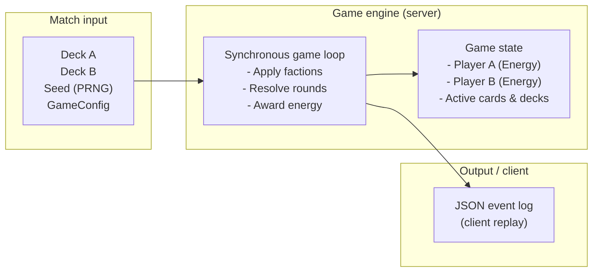
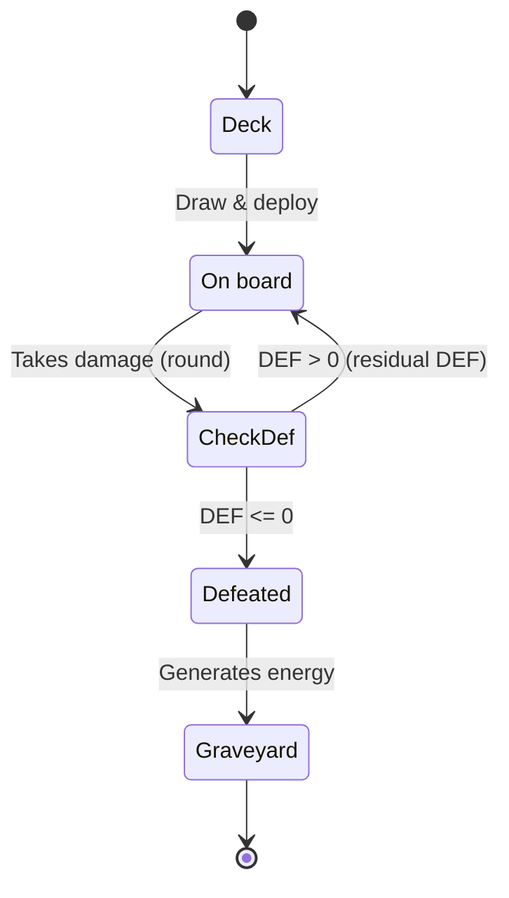
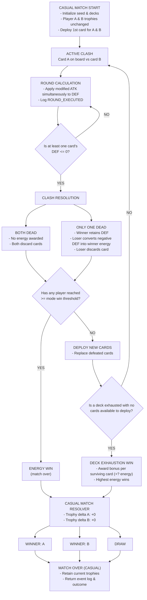
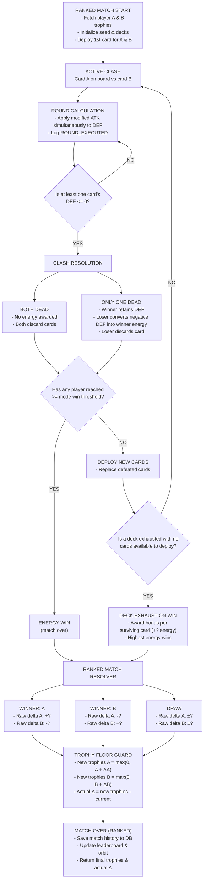

# Game engine schema

## 1. High-level architecture

## 2. Card lifecycle

## 3. Casual match flow (non-ranked)

## 4. Ranked match flow

## Notes

- Casual matches (Friend, Quick) give no rewards and do not change trophies.
- Win threshold is set per mode in GameConfig: Ranked 30, Friend 30, Quick 20? (to be tested).
- Ranked draw: Elo with score 0.5 for both. The player with more trophies loses some, the player with fewer gains some; the delta is 0 only when trophies are equal.