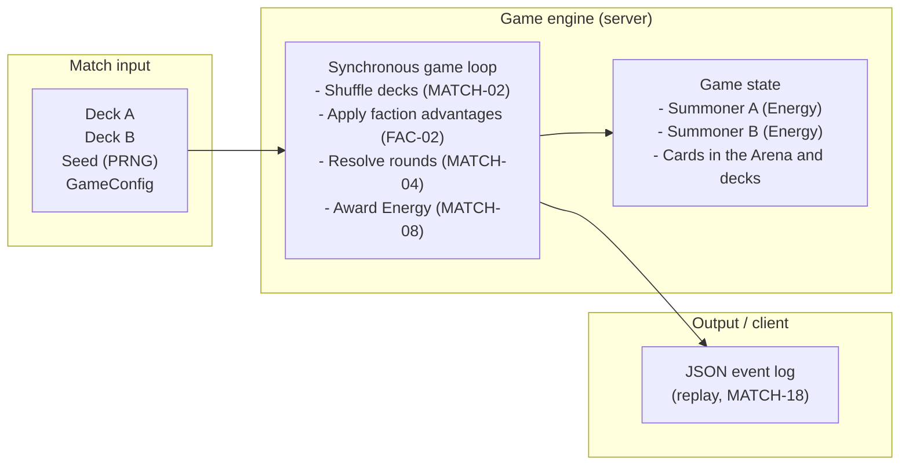
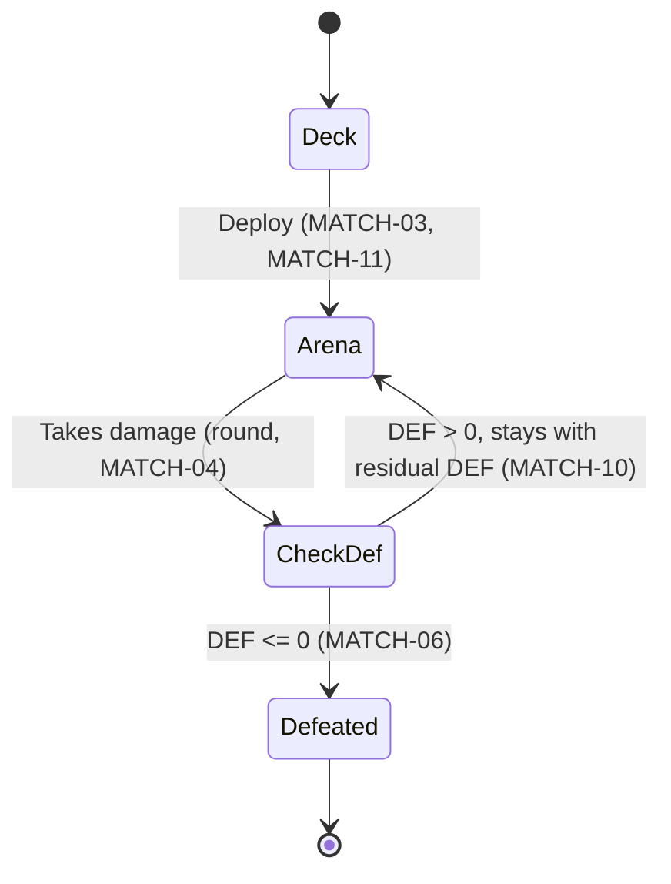
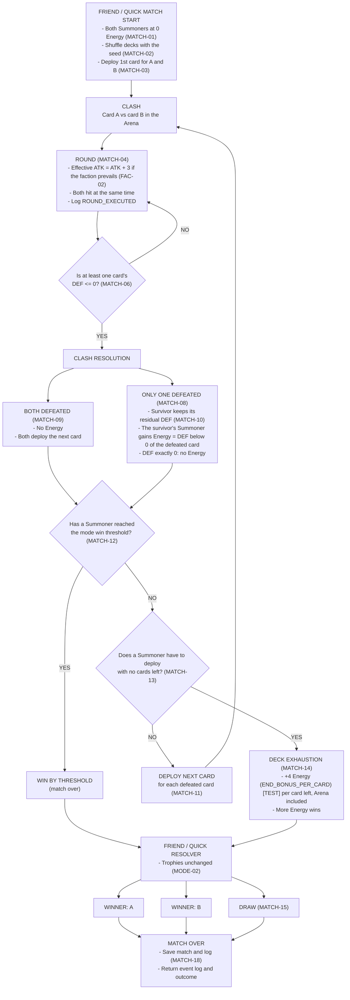
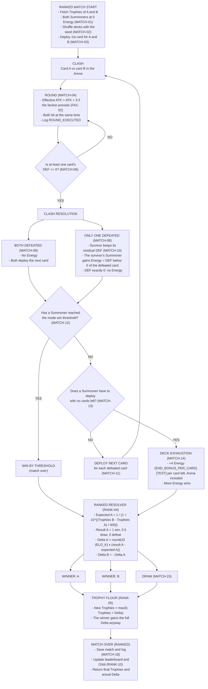

# Game engine schema

How the server simulates a match. The rules are in [match.md](https://github.com/horizon-glitch-studio/gruppo-08-will-of-the-void-docs/blob/main/rules/match.md); rule IDs (`MATCH-04`) and parameter names (`WIN_THRESHOLD_RANKED`) are the same as in the rules.

## 1. High-level architecture

## 2. Card lifecycle

A defeated card generates Energy only if it is the only one defeated and its DEF is below 0 (MATCH-08, MATCH-09).

## 3. Friend and Quick match flow

## 4. Ranked match flow

## Notes

- Friend and Quick matches give no rewards and do not change Trophies (MODE-02).
- Win threshold per mode in GameConfig (MATCH-12): Ranked 30 (`WIN_THRESHOLD_RANKED`), Friend 30 (`WIN_THRESHOLD_FRIEND`), Quick 20 (`WIN_THRESHOLD_QUICK`) [TEST].
- Going past the win threshold with the end bonus does not count as a win by threshold (MATCH-16).
- No turn limit (MATCH-17): every clash defeats at least one card, so a match lasts at most 59 clashes.
- Ranked draw: result 0.5 for both. The Summoner with more Trophies loses some, the one with fewer gains some; the change is 0 only when Trophies are equal (RANK-03, RANK-04).
- All values come from [parameters.md](https://github.com/horizon-glitch-studio/gruppo-08-will-of-the-void-docs/blob/main/rules/parameters.md).
